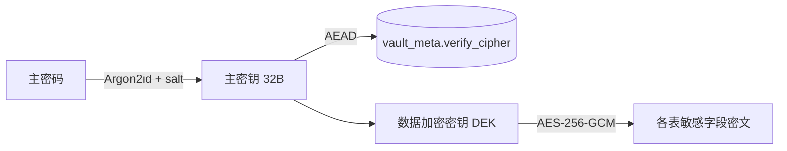

# WorkTools —— Go + Wails v3 运维桌面工作台

> 规划方案与目录结构设计文档
> 版本：v0.2  |  技术栈：Go 1.26 + Wails v3 + Vue3 + TS + Naive UI

---

## 1. 项目定位

一个**本地优先（local-first）、单文件分发**的运维桌面工具，把日常运维中散落的信息与操作收敛到一个加密工作台里：

| 序号 | 模块 | 解决的问题 |
|------|------|-----------|
| M1 | 常用 URL / 账号密码管理 | 环境地址、后台入口、登录账号散落各处，随手可查；一键打开并自动填写登录表单 |
| M2 | 个人重要密码保险箱 | 服务器 root、数据库、云平台 AK/SK 等强密码集中加密存放 |
| M3 | OTP 验证码管理 | TOTP 二次验证码本地生成，不依赖手机 App；支持 Google Authenticator 迁移格式互导 |
| M4 | 记事本 | Markdown 笔记，重要信息随手记录，支持导出 MD/HTML/PDF |
| M5 | 运维工具箱 | SSL 检测 / 端口探测 / 编解码 / 文本处理 / 密码生成 / 随机数据 / **图片压缩**等高频小工具 |
| M6 | 备份与恢复 | 全量加密备份导出/还原；密保问题重置主密码 |
| M7 | 私密文件 | 加密保存身份证复印件、营业执照等重要文件；分类、备注、预览与导出 |

**设计原则**

- **本地优先**：数据只存在本机，不联网、不上云、无遥测。
- **加密兜底**：所有敏感字段落盘前加密，主密码解锁，闲时自动锁定。
- **单文件**：编译产物为单个二进制，内置前端资源，拷走即用。
- **零 cgo**（尽量）：便于跨平台交叉编译，存储层优先选纯 Go 驱动。

---

## 2. 技术选型

| 层 | 选型 | 说明 |
|----|------|------|
| 桌面框架 | **Wails v3**（alpha，`wails3`） | Go 后端 + Web 前端，产物单二进制，比 Electron 轻 |
| 语言 | Go 1.26.x | 后端全部逻辑 |
| 前端 | **Vue3 + TypeScript + Vite**（已确认） | 组件丰富、上手快 |
| UI 组件库 | **Naive UI**（已确认） | 表格、表单、Modal 齐全 |
| 存储 | **SQLite（纯 Go：`modernc.org/sqlite`）**（已确认） | 避免 cgo，单文件数据库，事务可靠 |
| 加密 | **AES-256-GCM** 或 **XChaCha20-Poly1305**（`golang.org/x/crypto`） | 字段级加密 |
| 密钥派生 | **Argon2id**（`golang.org/x/crypto/argon2`） | 主密码 → 数据加密密钥 |
| OTP | `github.com/pquerna/otp`（TOTP/HOTP） | RFC 6238 / 4226 |
| 随机 | `crypto/rand` | OTP 密钥、盐值、Nonce |
| 剪贴板 | Wails v3 clipboard API | 复制密码/验证码，可设自动清空 |
| 配置 | `gopkg.in/yaml.v3` | 非敏感配置（主题、窗口尺寸等） |

> 备选：若初期想更快落地，可先用**加密 JSON 文件**（`data.vault`）替代 SQLite，接口层预留，后续平滑切换。

---

## 3. 目录结构设计

```
worktools/                       # Go module: github.com/aisreyu/worktools
├── docs/
│   └── PLAN.md                 # 本文档
├── build/                      # Wails v3 构建配置（config.yml、各平台打包模板）
├── Taskfile.yml                # APP_NAME=worktools，决定二进制名
├── go.mod / go.sum
├── README.md
├── main.go                     # Wails 应用入口：创建 App、注册 Service
│
├── internal/                   # 业务与领域逻辑（不依赖 Wails）
│   ├── vault/                  # 加密保险箱核心
│   │   ├── crypto.go           # Argon2id + AEAD 封装
│   │   ├── vault.go            # 打开/创建/锁定保险箱、默认分类播种
│   │   ├── recovery.go         # 密保问题与主密码重置
│   │   ├── backup.go           # 全量加密备份导出/还原
│   │   ├── repo.go             # URL / 密码条目仓储
│   │   ├── repo_notes.go       # 记事本仓储
│   │   ├── repo_schedules.go   # 日程仓储
│   │   ├── repo_files.go       # 私密文件仓储
│   │   ├── repo_categories.go  # 文件分类仓储
│   │   ├── repo_secret_categories.go # 密码分类仓储（自定义分类）
│   │   └── repo_clipboard.go   # 剪贴板历史仓储
│   ├── store/                  # 持久化层（纯 Go SQLite）
│   │   ├── store.go            # 打开数据库、迁移
│   │   ├── schema.sql          # 建表语句
│   │   └── models.go           # 领域模型
│   ├── otp/                    # TOTP/HOTP
│   │   ├── otp.go              # 业务封装（列表、实时码）
│   │   ├── migration.go        # Google Authenticator otpauth-migration:// 导入
│   │   ├── migration_export.go # 迁移格式导出（批量 URI / 二维码）
│   │   └── qr.go               # 二维码图片识别导入
│   ├── clipboard/              # 剪贴板历史与自动清空
│   │   ├── clipboard.go        # 历史记录与去重
│   │   ├── osclip_darwin.go    # macOS 系统剪贴板
│   │   └── ring.go             # 环形缓冲
│   ├── holiday/                # 节假日/工作日判定
│   ├── toolbox/                # 运维工具箱纯函数（SSL/端口/编解码/JWT/K8s/
│   │                           #   子网/cron/日志时间/图片压缩/水印/二维码/压缩包…）
│   └── config/                 # 非敏感配置读写（桌面/移动端基准目录）
│
├── services/                   # Wails v3 Service，暴露给前端（绑定层）
│   ├── vault_service.go        # 解锁/锁定/改主密码/密保重置、URL 与密码 CRUD、密码分类 CRUD
│   ├── otp_service.go          # M3 OTP（含迁移导入导出）
│   ├── note_service.go         # M4 记事本
│   ├── file_service.go         # M7 私密文件（加密文件存取 + 分类）
│   ├── schedule_service.go     # 日程与提醒（DueForNotify / 系统通知）
│   ├── clipboard_service.go    # 剪贴板历史
│   ├── toolbox_service.go      # M5 工具箱（含密码存入保险箱、图片压缩）
│   ├── workbench_service.go    # 工作台聚合视图
│   ├── backup_service.go       # M6 备份导出/导入
│   ├── openurl_service.go      # 打开 URL 并注入自动填写脚本
│   ├── export_service.go       # 文件导出（MD/HTML 等）
│   └── app_service.go          # 平台信息
│
└── frontend/
    ├── index.html
    ├── package.json
    ├── vite.config.ts
    ├── src/
    │   ├── main.ts
    │   ├── App.vue             # 全局：自动锁定、全局日程提醒轮询
    │   ├── router/
    │   ├── lib/                # 前端工具（api 封装、i18n、主题、自动锁定、
    │   │                       #   剪贴板自动清空、日程提醒、农历、Markdown…）
    │   ├── views/
    │   │   ├── Unlock.vue      # 主密码解锁页
    │   │   ├── Urls.vue        # M1
    │   │   ├── Secrets.vue     # M2（含自定义分类管理、置顶、复制自动清空）
    │   │   ├── Otp.vue         # M3
    │   │   ├── Notes.vue       # M4 记事本（Markdown）
    │   │   ├── Files.vue       # M7 私密文件
    │   │   ├── Schedule.vue    # 日程
    │   │   ├── Calendar.vue    # 日历
    │   │   ├── Toolbox.vue     # M5
    │   │   └── Settings.vue    # 设置（改密码、密保、备份、自动锁定、剪贴板清空）
    │   └── components/
    └── bindings/               # Wails 自动生成的 TS 绑定（勿手改）
```

**分层约定**

- `internal/*`：纯 Go 领域逻辑，可单测，不知道 Wails 存在。
- `services/*`：唯一与前端交互的边界（Wails v3 的 Service 可导出方法），做参数校验、错误翻译、脱敏。
- `frontend/*`：只通过 `bindings` 调用后端，不直连数据库。

---

## 4. 数据模型

> 所有 `secret` 类字段以**密文 + Nonce** 存储，解密仅发生在内存。

### 4.1 元信息表

```sql
-- 保险箱元信息（单行）
CREATE TABLE vault_meta (
  id            INTEGER PRIMARY KEY CHECK (id = 1),
  version       INTEGER NOT NULL,      -- 数据格式版本
  kdf           TEXT    NOT NULL,      -- 'argon2id'
  kdf_salt      BLOB    NOT NULL,      -- 盐
  kdf_params    TEXT    NOT NULL,      -- 时间/内存/并行度参数(JSON)
  verify_cipher BLOB    NOT NULL,      -- 校验密文(解密成功即主密码正确)
  verify_nonce  BLOB    NOT NULL,
  created_at    INTEGER NOT NULL,
  updated_at    INTEGER NOT NULL
);
```

### 4.2 M1 常用 URL / 账号

```sql
CREATE TABLE url_entries (
  id          INTEGER PRIMARY KEY AUTOINCREMENT,
  title       TEXT NOT NULL,           -- 名称，如 "生产 JumpServer"
  url         TEXT NOT NULL,
  env         TEXT,                    -- 环境：prod/uat/sat/dev
  tags        TEXT,                    -- 逗号分隔标签
  username    TEXT,
  password_ct BLOB,                    -- 密码密文
  password_nonce BLOB,
  note        TEXT,
  created_at  INTEGER, updated_at INTEGER
);
```

### 4.3 M2 个人重要密码保险箱

```sql
CREATE TABLE secret_entries (
  id          INTEGER PRIMARY KEY AUTOINCREMENT,
  title       TEXT NOT NULL,           -- 如 "华为云 AK"
  category    TEXT,                    -- server/db/cloud/other
  host        TEXT,                    -- 主机/IP/连接串
  port        INTEGER,
  username    TEXT,
  password_ct BLOB NOT NULL,
  password_nonce BLOB NOT NULL,
  extra_ct    BLOB,                    -- 附加敏感信息(私钥、AK/SK等)密文
  extra_nonce BLOB,
  note        TEXT,
  pinned      INTEGER DEFAULT 0,       -- 置顶/收藏
  created_at  INTEGER, updated_at INTEGER
);

-- 密码分类（自定义；内置 server/database/cloud/other 四项）
CREATE TABLE secret_categories (
  id          INTEGER PRIMARY KEY AUTOINCREMENT,
  code        TEXT NOT NULL,           -- 稳定 slug，被 secret_entries.category 引用
  name_ct     BLOB NOT NULL,           -- 分类名密文
  name_nonce  BLOB NOT NULL,
  sort_order  INTEGER DEFAULT 0,
  created_at  INTEGER, updated_at INTEGER
);
CREATE UNIQUE INDEX idx_secret_categories_code ON secret_categories(code);
```

### 4.4 M3 OTP

```sql
CREATE TABLE otp_entries (
  id          INTEGER PRIMARY KEY AUTOINCREMENT,
  title       TEXT NOT NULL,           -- 如 "github: alice"
  issuer      TEXT,
  account     TEXT,
  secret_ct   BLOB NOT NULL,           -- Base32 密钥密文
  secret_nonce BLOB NOT NULL,
  algorithm   TEXT DEFAULT 'SHA1',     -- SHA1/SHA256/SHA512
  digits      INTEGER DEFAULT 6,
  period      INTEGER DEFAULT 30,
  otp_type    TEXT DEFAULT 'totp',     -- totp/hotp
  counter     INTEGER DEFAULT 0,
  created_at  INTEGER, updated_at INTEGER
);
```

### 4.5 M4 记事本

```sql
CREATE TABLE note_entries (
  id          INTEGER PRIMARY KEY AUTOINCREMENT,
  title       TEXT NOT NULL,
  content     TEXT NOT NULL,           -- Markdown 正文（明文，非敏感）
  created_at  INTEGER, updated_at INTEGER
);
```

### 4.6 密保问题（主密码重置）

```sql
CREATE TABLE recovery_questions (
  id          INTEGER PRIMARY KEY AUTOINCREMENT,
  question    TEXT NOT NULL,
  answer_hash TEXT NOT NULL,           -- Argon2id 哈希，不可逆
  created_at  INTEGER, updated_at INTEGER
);
```

---

## 5. 安全设计

### 5.1 密钥与加解密流程



- **主密码**从不落盘，仅用于派生。派生后**驻留内存**（解锁会话），锁定即清零（手动 `zero`）。
- **解锁校验**：用派生的 MKey 解密 `verify_cipher`，成功即密码正确（避免用哈希直接比较）。
- **字段级加密**：每条敏感记录独立随机 Nonce，密文与 Nonce 同库存放。
- **AAD 绑定**：以 `表名:字段` 作为附加认证数据，防止密文被跨字段搬运。
- **自动锁定**：可配置 N 分钟无操作锁定；`Cmd+L` 手动锁定；窗口失焦可选锁定。
- **剪贴板**：复制密码/验证码后默认 30s 自动清空（可关闭）。

### 5.2 威胁模型与边界

| 场景 | 处理 |
|------|------|
| 数据库文件被拷走 | 无主密码无法解密，Argon2id 抗暴力 |
| 内存转储 | 尽量缩短密钥驻留，锁定清零；不做过度承诺 |
| 误删/损坏 | 支持导出加密备份文件，导入恢复 |
| 忘记主密码 | 密保问题答案哈希校验，通过后重置主密码 |
| 明文配置泄露 | 非敏感配置与敏感数据分离，配置不含密钥 |

> 明确不做：不含硬件安全模块的强制绑定。可作为**可选项**：用 macOS Keychain 保存主密码以便快速解锁。

---

## 6. 模块详细设计

### M1 常用 URL / 账号密码
- 列表视图：按环境/标签过滤，搜索（名称、URL、标签）。
- 一键操作：打开浏览器、复制 URL、复制账号、复制密码（自动清空）。
- **打开并自动填写**：点击链接打开浏览器，自动注入脚本填写用户名/密码登录表单。
- **一键复制全部**：URL、账号、密码、备注一次性复制。
- 表单：名称、URL、环境、标签、账号、密码、备注。

### M2 个人重要密码保险箱
- 分类：服务器 / 数据库 / 云平台 / 其他 / 生成（工具箱存入）。
- 强度提示：本地强度评估（可选）。
- 密码生成器：长度、大小写、数字、符号、排除易混淆字符。
- **默认列表不显示明文**，点击"眼睛"临时显示；复制后自动清空剪贴板。

### M3 OTP 验证码
- 支持 **TOTP**（主流）+ HOTP；解析 `otpauth://totp/...` URI 与 Base32 密钥录入。
- 实时倒计时圆环，剩 N 秒变红提示。
- 一键复制当前码（仅当剩余时间 > 3s 时允许）。
- **Google Authenticator 迁移互导**：解析 `otpauth-migration://` 批量导入（含二维码图片识别）；反向导出为迁移 URI / 二维码，可迁移到其他验证器平台。
- **明文恢复码导出**：一键导出全部（或所选）OTP 为可读文本（标题 / 发行方 / 账号 / 类型 / Base32 密钥 / otpauth URI），用于离线备份与打印，防止设备丢失后锁死。

### M4 记事本
- 多条笔记独立管理（新建 / 编辑 / 删除）。
- **Markdown 编辑 + 实时预览**。
- 导出 Markdown / HTML / PDF。

### M5 运维工具箱
| 工具 | 说明 |
|------|------|
| SSL 检测 | 证书链、有效期、协议版本、加密套件、评级（参考 SSL Labs） |
| 端口探测 | 单/多端口，超时设置 |
| HTTP 探测 | 状态码、响应头、耗时 |
| DNS 查询 | A/AAAA/CNAME/MX/TXT |
| Base64/URL/Hex | 编解码互转 |
| 哈希 | MD5/SHA1/SHA256 |
| JSON 格式化 | 美化 / 压缩 / 校验 |
| 时间戳转换 | 秒/毫秒 ↔ 本地/UTC 时间 |
| 子网计算 | CIDR ↔ 掩码、可用地址段 |
| 文本处理 | 行转列、列转行、多列拼接、加单/双引号、文本 ↔ JSON、去重排序 |
| 前后缀拼接 | 自定义前后缀批量拼接（如 `http://` + `api.apitd` + `.net`） |
| 密码生成 | 低/中/高档位 + 自定义字符类/符号/排除易混淆，可存入保险箱 |
| 随机数据 | 随机邮箱、手机号、身份证号（含校验码） |
| 图片压缩 | 目标体积 / 最长边 / 质量 / 格式，批量压缩，逐个保存或打包 ZIP 导出 |
| 图片格式转换 | PNG / JPEG / GIF / BMP / TIFF 批量互转，可限制最长边并对 JPEG 指定质量，逐个保存或打包 ZIP 导出 |
| 水印工具 | 图片 / PDF 加水印，支持批量、文字内容、字体大小 / 字体、颜色、透明度、角度与倾斜（对角线）、平铺与密集程度、锚点、旋转（图片与 PDF）、预览，批量结果打包 ZIP 导出 |
| 文件夹打包 | 选择一个或多个文件夹，递归压缩为同名 ZIP（存放在源文件夹同级目录） |

> 工具箱内按使用频次排序：**日常工具**（图片压缩、格式转换、水印、密码生成、时间戳、时间差、二维码）优先展示，其次文本工具、运维工具。

> 工具箱为**无状态纯操作**（密码存入保险箱除外，需解锁状态），可独立页面直接使用。

### M6 备份与设置
- 全量加密备份导出 / 还原。
- **自动备份**：定期将加密库导出到指定本地目录，按 `worktools-autobackup-YYYYMMDD-HHMMSS.json` 命名，保留最近 N 份轮转（默认每天、保留 7 份）；备份密码加密存于库中（需解锁），仅在主库解锁时于后台调度执行，可随时「立即备份」。
- 修改主密码。
- **密保问题**：设置 3 个密保问题，凭密保答案重置主密码。
- **外观**：主题模式（跟随系统 / 浅色 / 深色）与主题色（预设色板 + 自定义取色），立即生效并持久化到本地。

### M7 私密文件
- 加密保存身份证复印件、营业执照、合同、证书等重要文件，仅在解锁后可见。
- **双存储**：≤ 512KB 的文件密文（`nonce || 密文`，AAD 绑定 `file_entries:data`）直接存入 SQLite；更大的文件加密落盘到 `<数据目录>/files/<hex>.enc`，数据库中仅存路径。替换或删除时同步清理旧磁盘密文。
- 支持分类（身份证件 / 营业执照 / 合同协议 / 证书资质 / 财务凭证 / 其他）、标题搜索、备注、图片与 PDF 预览及明文导出。
- **自定义分类**：分类名称加密（AAD `file_categories:name`）存库，可自行新建、重命名、删除（如“企业主体”）。每个分类使用稳定 slug `code`，文件按 `code` 归类，重命名不会使文件失联；删除仍被占用的分类会被拒绝。首次解锁时自动写入内置分类，之后不再覆盖用户的增删改。
- 备份导出时文件正文一并打包（超过 16MB 的条目跳过，保持备份体积可控）。

### 图片压缩（M5 工具箱）
- 设定目标大小（KB）、最长边像素、质量与输出格式（自动 / JPEG / PNG）。
- **自动格式**：含透明通道输出 PNG、否则 JPEG；目标大小通过二分搜索 JPEG 质量逼近，必要时按最长边等比缩放。
- 支持**批量**选择图片，无需预先指定输出目录：处理结果展示原图 / 压缩后体积、压缩比与是否达标，可**逐个保存**（另存为对话框）或**一键打包为 ZIP 导出**。
- **文件夹打包**：可选择一个或多个文件夹，各自递归压缩为同名 ZIP（存放在源文件夹同级目录），无需指定输出目录。

### 图片格式转换（M5 工具箱）
- 在常见格式间互转：**PNG / JPEG / GIF / BMP / TIFF**（`webp` 仅支持作为输入，Go 侧无纯编码器）。
- 可限制**最长边**像素（0 保留原始尺寸）并对 JPEG 指定**质量**；支持批量选择。
- 处理结果展示原格式 → 目标格式、尺寸与体积，可**逐个保存**或**一键打包为 ZIP 导出**。

### 水印工具（M5 工具箱）
- 支持**图片**（jpg/jpeg/png/gif/bmp/webp/tif/tiff）与 **PDF** 文件添加水印，支持**批量**选择与处理。
- 水印参数：文字内容、字体大小、字体（无衬线 / 衬线 / 等宽）、颜色、透明度、角度、**倾斜方案**（对角线）、平铺、**密集程度**、锚点（九宫格）、是否置于上层。
- **密集程度**：平铺模式下的排布密度，取值为 20–300 的百分比（越大越密），同时支持滑杆与数值输入；图片与 PDF 均生效。字号决定单个水印的大小，密集程度只决定水印之间的间距（20% 时间距为水印尺寸的 100%，100% 时为 25%，300% 时水印边缘相接），因此调高密度不会缩小水印。
- **旋转**：图片与 PDF 均支持 90° / 180° / 270° 旋转。旋转在**编辑过程中**生效（预览即所见），导出文件同时包含旋转后的页面与水印。
- **PDF 指定页**：支持 `1,3,5-8` 形式的页码选择，留空表示全部页面。
- **预览**：图片直接在应用内预览（base64 PNG，等比缩放）；PDF 使用系统缩略图（macOS `qlmanage`，其他平台提示不支持）。
- 输出：无需预先指定输出目录。**单个文件**通过另存为对话框导出；**多个文件**一键打包为 ZIP 导出。默认文件名加后缀（`_wm` / `_min`）避免覆盖原文件。

---

## 7. 里程碑

| 阶段 | 内容 | 产出 |
|------|------|------|
| P0 脚手架 | `wails3 init`、目录骨架、Service 注册、前端壳 | 能 `wails3 dev` 跑起来 ✅ |
| P1 保险箱内核 | Argon2id + AEAD、vault_meta、解锁/锁定页 | 能设主密码并解锁 ✅ |
| P2 M1 + M2 | URL/账号 + 密码保险箱 CRUD、复制清空、打开自动填写 | 核心可用 ✅ |
| P3 M3 | TOTP 录入与实时码、迁移互导 | OTP 可用 ✅ |
| P4 M4 | 记事本（Markdown/导出）+ 工具箱 | 工具可用 ✅ |
| P5 打磨 | 自动锁定、备份导入导出、密保重置、主题、打包 | 可分发单文件 ✅ |

---

## 8. 开发环境与常用命令

```bash
# 安装 Wails v3 CLI（alpha）
go install github.com/wailsapp/wails/v3/cmd/wails3@latest

# 环境自检
wails3 doctor

# 开发（热重载）
wails3 dev -config ./build/config.yml -port 9245

# 重新生成前端绑定（改动 services/ 后；-ts 必须带，否则前端导入断裂白屏）
wails3 generate bindings -d frontend/bindings -ts

# 构建当前平台
wails3 build

# 打包
wails3 package
```

**环境依赖**：Go ≥ 1.25、Node ≥ 18、Wails v3 CLI。

---

## 9. 已确认决策

| 项目 | 决策 |
|------|------|

| 前端框架 | Vue3 + TS + Vite + Naive UI ✅ |
| 存储 | SQLite（纯 Go） ✅ |
| OTP 范围 | TOTP + HOTP + otpauth:// URI + 迁移互导 ✅ |
| 目标平台 | macOS + Windows + Linux ✅ |
| 主密码快捷解锁 | 待定（系统钥匙串可选） |
| 工具箱清单 | 按需持续增补 ✅ |

---

## 10. 功能增强建议清单（26 项）

以下为按使用场景归类的增强建议，已按「日常使用 / 日常工具 / 运维工具」三块落地，作为后续迭代依据。

### 10.1 日常使用（8 项）

| # | 功能 | 说明 | 状态 |
|---|------|------|------|
| 1 | 全局快速搜索 | `Cmd/Ctrl+K` 命令面板，跨 URL/密码/OTP/记事/日程/工具/文件/剪贴板统一检索并跳转 | ✅ |
| 2 | 密码健康审计 | 检测弱密码、重复使用、长期未更新（默认 90 天），输出分级报告，风险清单支持一键筛选 | ✅ |
| 3 | URL 批量健康监测 | 并发探测可达性 + HTTPS 证书有效期，卡片实时状态点 | ✅ |
| 4 | 系统托盘 + 快捷锁定 | 托盘菜单（显示/隐藏/锁定/退出）+ 全局快捷键 `Cmd/Ctrl+L` 锁定、`Cmd/Ctrl+Shift+W` 隐藏 | ✅ |
| 5 | 剪贴板历史 | 内存环形记录（最多 50 条），支持固定、自动/手动清理 | ✅ |
| 6 | 外部数据导入 | 解析 KeePass / Chrome / 1Password CSV，预览后追加导入 | ✅ |
| 7 | 笔记附件（图片） | 粘贴/拖拽/选择图片作为附件，随正文一起加密存储 | ✅ |
| 8 | 加密笔记选项 | 单条笔记可标记为敏感，仅经保险箱加密通道读写 | ✅ |

### 10.2 日常工具（10 项）

| # | 功能 | 说明 | 状态 |
|---|------|------|------|
| 1 | URL 编解码 | URL 百分号编解码 | ✅ |
| 2 | JWT 解码 | 解析 JWT Header/Payload，展示过期时间 | ✅ |
| 3 | Cron 表达式解析 | 解析 5/6 段 cron，计算下次触发时间 | ✅ |
| 4 | 身份信息生成 | 生成随机身份证/手机号等测试数据 | ✅ |
| 5 | YAML 工具 | YAML↔JSON 转换与格式校验 | ✅ |
| 6 | 时间差计算 | 两时间戳/日期差值（天/时/分/秒） | ✅ |
| 7 | 正则测试器 | 实时匹配 + 捕获组高亮 | ✅ |
| 8 | 文本 Diff | 逐行差异对比 | ✅ |
| 9 | CSV 转 SQL | CSV 生成 INSERT 语句 | ✅ |
| 10 | 二维码生成 | 文本/URL 生成二维码并下载 | ✅ |

### 10.3 运维工具（9 项）

| # | 功能 | 说明 | 状态 |
|---|------|------|------|
| 1 | 自签证书生成 | 生成自签证书 / CSR（支持 SAN、CA） | ✅ |
| 2 | 连接串解析 | 解析/构建 DSN 连接串 | ✅ |
| 3 | K8s 资源计算 | CPU/内存单位换算 + resources YAML 校验 | ✅ |
| 4 | 日志时间戳识别 | 自动识别日志时间格式并转换 | ✅ |
| 5 | 端口扫描 | 常用端口组扫描，支持范围展开 | ✅ |
| 6 | WHOIS 查询 | 域名注册信息查询 | ✅ |
| 7 | IP 归属地 | IP/域名地理位置、运营商、AS 查询，支持单/批量 | ✅ |
| 8 | DNS 查询 | A/AAAA/CNAME/MX/TXT 等记录查询 | ✅ |
| 9 | SSL/子网/WHTTP 等 | SSL 证书检查、子网计算、HTTP 探测、TCPing | ✅ |

### 10.4 数据库迁移

日常使用功能为 `note_entries` 表新增了 `sensitive` 与 `attach_*` 列。由于 schema 使用 `CREATE TABLE IF NOT EXISTS`，已有数据库不会自动获得新列。`store.Open` 现在会在应用 schema 后执行一次幂等的 `migrate`（基于 `PRAGMA table_info` 检查并 `ALTER TABLE ADD COLUMN`），确保旧库平滑升级；`internal/store/store_test.go` 覆盖旧库与全新库两种场景。

### 10.5 运维协作增强（5 项）

| # | 功能 | 说明 | 状态 |
|---|------|------|------|
| 1 | 回收站（软删除） | URL/密码/OTP/笔记/文件删除后进入回收站，可还原或彻底删除；解锁时自动清理 30 天前的条目，清理时同步删除磁盘密文 | ✅ |
| 2 | 日程重复 | 日程支持「不重复 / 每日 / 每周 / 每月」，标记完成时自动顺延下次日期并清除完成/提醒状态 | ✅ |
| 3 | 备份历史还原 | 设置页列出自动备份文件（时间、大小），可直接选择某份备份并输入密码还原，用于误操作或历史版本回滚 | ✅ |
| 4 | URL 按环境批量打开 | 为 URL 条目指定环境标签后，可一键批量打开同一环境下的全部 URL（运维切换环境时高效） | ✅ |
| 5 | 搜索深链定位 | 命令面板检索到某条目后跳转对应页面并自动滚动 + 高亮该条目（`data-hid` + 路由 query） | ✅ |

> 上述功能为软删除与增量迁移：`url_entries`/`secret_entries`/`otp_entries`/`note_entries`/`file_entries` 新增 `deleted_at`（及部分 `deleted_from`）列，`schedule_entries` 新增 `recur` 列，均由 `store.migrate` 幂等补列。
